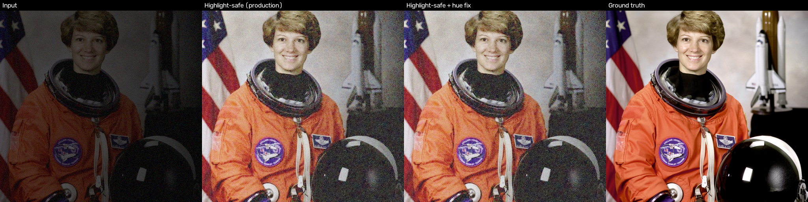

# Highlight hue-preservation fix: study and integration

**Status: integrated in Natural and Highlight-safe on branch `integration/highlight-hue`, pending review. Not merged to `main`, not deployed.** Quick (classical) is unchanged.

**Problem.** Where the input is already (nearly) clipped, such as a bright window or lamp in a dark room, Retinexformer's
illumination division moves the colour channels by different amounts, so white turns orange and the region gets darker
(measured on a user photo: window RGB 0.96/0.95/0.89 -> 0.75/0.48/0.08). QGH's highlight step only rolls off luminance.

**Fix** (`lumen/hybrid/highlight_hue.py`). In a soft mask of near-clipped input pixels, take the colour from the
input and keep the model's brightness, with a floor so the region is not darker than the input. Outside the mask the
image is bit-identical. Nothing is learned; the model is untouched.

**Selection (dev only):** 48 settings on 50 synthetic high-contrast LOL-v2 Train photos, 90 real LOL-v2 pairs and 90
noisy/clean synthetic images. Chosen: `start 0.80, full 0.95, chroma_strength 1.0, lum_keep 1.0`
(`configs/experimental/highlight_hue.yaml`). Held-out sets were not used for selection.

## Held-out results (run once; Highlight-safe = production QGH)

| Set | Method | PSNR | SSIM | LPIPS | NIQE | Highlight a*b* error vs GT |
|---|---|---|---|---|---|---|
| hc_eval, 60 synthetic bright-window photos | Highlight-safe | 14.96 | 0.6258 | 0.3912 | 4.07 | 66.96 |
| | **+ hue fix** | **17.41** | **0.6676** | **0.3295** | 4.04 | **4.37** |
| lolv2_syn, 100 (low-light pairs) | Highlight-safe | 16.51 | 0.7698 | 0.2515 | 4.15 | 43.62 |
| | **+ hue fix** | **17.43** | **0.7838** | **0.2289** | 4.15 | **9.44** |
| eval15, 15 (LOL-v1) | Highlight-safe | 25.12 | 0.8441 | 0.1314 | 3.48 | 53.05 |
| | + hue fix | 25.12 | 0.8441 | 0.1314 | 3.48 | 54.72 |
| syn_noisy / syn_clean, 100 + 100 | both | identical to Highlight-safe (0.000 dB change) | | | | |
| app examples (4) | both | identical | | | | |

Natural style (Standard) behaves the same way: hc_eval 14.49 -> 16.86 dB, eval15 25.15 -> 25.16 dB.
Latency of the fix alone: 14-23 ms at 600x400, 68-76 ms on the larger high-contrast images, 93 ms on the unseen photos.
Where no input pixel is near-clipped (syn_clean, syn_noisy, examples) the output is exactly unchanged.

## Caveats (please read before deciding)
- **hc_eval is synthetic and built the same way as the dev set** (bright regions kept bright, the rest darkened), so it
  mirrors the failure by construction; the gain there is expected and overstates real-world gain. The real-image
  evidence is: lolv2_syn (+0.9 dB), eval15 (neutral), and the supplied bright-window photo (orange -> white).
- The "Highlight a*b* error" on eval15 slightly rises (53.05 -> 54.72): eval15 has almost no clipped input, so the
  metric covers very few pixels there.
- On the 20 unseen real photos there is no ground truth. Their colour distance to the *input* in clipped areas drops
  (30.0 -> 10.8), which shows consistency with the input, not correctness.
- With QGH after the fix, the highlight roll-off darkens the restored region again (luminance gap 0.059 vs 0.014 for
  Natural + fix). Applying the fix after QGH, or reducing the roll-off inside the mask, was not tested.
- Real photos with clipped highlights *and* ground truth were not available; this should be checked before release.

## Integration (final)

**Where it runs.** `LumenPipeline.run(..., highlight_hue=True)` (default `False`, so the research and evaluation paths and the
Phase 5 numbers are reproduced exactly). The app service turns it on for **Natural** and **Highlight-safe** only; **Quick** is
never touched. Config: `configs/highlight_hue.yaml` (strict loader; a missing or invalid file disables only the fix, with the
reason logged and shown in `/api/status` under `technical.highlight_hue`; it never falls back to defaults silently).
`LUMEN_HIGHLIGHT_HUE=0` switches it off, `LUMEN_HUE_CONFIG` points to another file.

**Stage.** Highlight-safe = model -> **hue fix** -> QGH (noise, then highlight roll-off). QGH's code is unchanged.
Both orders were compared on dev data only (50 synthetic high-contrast images):

| Order | PSNR | SSIM | LPIPS | Highlight a*b* error | Highlight brightness gap vs GT | Over-exposed pixels |
|---|---|---|---|---|---|---|
| QGH only (before) | 14.71 | 0.641 | 0.370 | 63.1 | 0.305 | 1.12 % |
| hue -> QGH (**chosen**) | 17.76 | 0.691 | 0.298 | 3.84 | 0.055 | **0.125 %** |
| QGH -> hue | 17.82 | 0.691 | 0.298 | 3.89 | 0.014 | 3.22 % |

Running the fix after QGH matches the ground-truth brightness slightly better but **undoes the roll-off** (over-exposure back to
3.2 %), so it was not chosen. The "QGH darkens the corrected highlights again" report is the roll-off working as designed: it
compresses brightness above its knee (0.7). With the fix first, highlights are 0.055 from the ground truth instead of 0.305.

**Repeat of the evaluation through the real pipeline** (`scripts/highlight_hue_integration_check.py`; before = flag off,
after = flag on; identical inputs). Natural / Highlight-safe:

| Set | PSNR before -> after | SSIM | LPIPS | NIQE | Bit-identical outputs |
|---|---|---|---|---|---|
| eval15 (15) | 25.15 -> 25.16 / 25.12 -> 25.12 | 0.8441 -> 0.8441 | 0.1314 -> 0.1314 | 3.48 -> 3.48 | 14 / 15 |
| LOL-v2 synthetic pairs (100) | 16.19 -> 17.10 / 16.51 -> **17.43** | 0.765 -> 0.781 / 0.770 -> 0.784 | 0.252 -> 0.229 / 0.252 -> 0.229 | 4.11 -> 4.10 / 4.15 -> 4.15 | 9 / 100 |
| High-contrast test photos (60, synthetic) | 14.49 -> 16.86 / 14.96 -> **17.41** | 0.619 -> 0.661 / 0.626 -> 0.668 | 0.400 -> 0.339 / 0.391 -> 0.330 | 4.10 -> 4.00 / 4.07 -> 4.04 | 1 / 60 |
| Noisy synthetic (50) | unchanged | unchanged | unchanged | unchanged | 50 / 50 |
| Clean synthetic (50) | unchanged | unchanged | unchanged | unchanged | 50 / 50 |
| App examples (4) | unchanged | unchanged | unchanged | unchanged | 4 / 4 |
| Unseen real photos (20, no ground truth) | n/a | n/a | n/a | 3.82 -> 3.83 / 3.80 -> 3.80 | 4 / 20 |

Highlight colour error vs ground truth (a*b*): high-contrast 67.5 -> 4.5 (Natural) and 67.0 -> 4.4 (Highlight-safe);
LOL-v2 pairs 44.4 -> 9.7 and 43.6 -> 9.4. eval15 53.05 -> 54.72 (almost no clipped pixels there, so very few pixels count).
Highlight-safe over-exposure: high-contrast 0.95 % -> 0.09 %; LOL-v2 pairs 1.06 % -> 0.84 %; on the unseen photos it rose
from 0.86 % to 1.10 %, because bright regions whose true colour is white are no longer left orange-and-darker.

**Regression checks.** Where no input pixel is near-clipped, output is bit-identical (all noisy/clean synthetic and app
examples; 14 of 15 eval15 images). Phase 5 numbers (25.15 / 0.8441 / 0.1314 and 25.12 for QGH) are reproduced exactly by the
"before" variants. Test suite: 186 passed (180 existing + 6 for the fix and its integration).

**End-to-end app check** (local, port 7881, real HTTP): `scripts/smoke_test_app.py` ALL PASSED (3 styles x 4 examples,
Compare All with one network run, invalid uploads, `/healthz`, assets; NIQE checked as available because the local venv has
pyiqa). Restore PNGs decode (downloads). On the bright-window photo the window is white again (RGB 0.97/0.95/0.88 Natural,
0.92/0.91/0.83 Highlight-safe, instead of 0.75/0.48/0.08); Quick still returns 0.88/0.90/0.93. The Details payload reports
`highlight_hue: {applied, coverage, ms}`.

**Latency.** The fix needs no extra model call. Laptop GPU pipeline, median per image: Natural +14 ms (no clipped pixels)
to +80 ms (large clipped regions); Highlight-safe +14 to +100 ms. 2 CPU threads at 768x512: **22 ms** with no clipped pixels,
about **195 ms** with a clipped window, against about 5.9 s for a whole restoration on 2 vCPU (about 3 %). Container-level
timing was not re-measured.

## Remaining caveats
- The high-contrast test set is synthetic and built like the dev set, so it overstates real-world gain. Real evidence is the
  LOL-v2 pairs (+0.9 dB), neutral eval15, and the bright-window photo. No real clipped-highlight photos with ground truth
  were available.
- With the fix first, Highlight-safe highlights are still slightly darker than the ground truth (gap 0.055): that is the roll-off.
- On unseen photos there is no ground truth, so colour consistency with the input, not correctness, is what improves.
