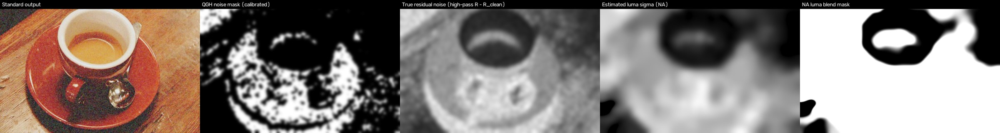
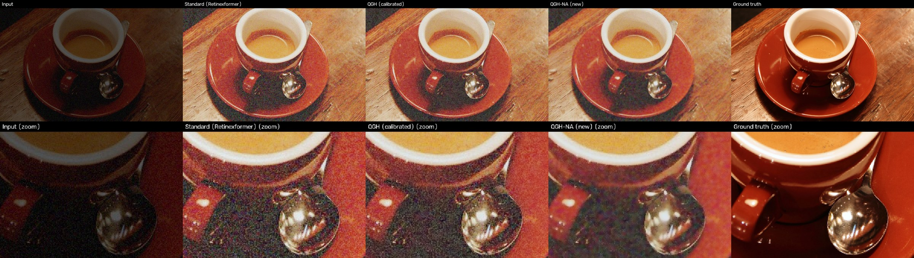

# LUMEN - Residual noise study (experimental)

**Status:** research only. **No production default was changed:** Natural = Retinexformer, Highlight-safe = the
calibrated QGH (`configs/quality_guided.yaml`), and the Phase 5 results stand as reported. The variants below
live in `lumen/experimental/` and `configs/experimental/` and are not reachable from the app.

| Iteration | Variant | Verdict |
|---|---|---|
| 1 | **QGH-NA v1**: noise-aware refinement replacing the QGH noise step | **Do not integrate.** Large gains on noisy images, but regressions on clean, finely detailed images (faint handwriting erased) |
| 2 | **QGH-NA v2**: one controlled fix iteration | Meets the criteria on aggregate (noise down, clean and fine detail at QGH level); one noisy-image regression remains. **Not integrated** (release freeze). See section 9 |

Reproduce: `python scripts/noise_study.py build | search | eval | figures | latency | report`.
Raw results: `results/noise_study/` (`eval_tables.md`, `eval_results.json`, `latency_*threads.json`, `figures/`) - generated locally and not versioned. Figures in `docs/figures/` show only CC0 scikit-image material; figures of dataset (LOL, LOL-v2/RAISE) or web photos stay local, in line with `app/examples/SOURCES.md`.

---

## 1. Root cause: why the coffee photo stays grainy

Measured on `app/examples/coffee_dark.jpg`. It is synthetic, so the noise-free version of the same dark photo
exists: `data/noise_study/examples_clean/`. **R** is Retinexformer's output on the noisy input, **R_clean** its
output on the noise-free input, so `R - R_clean` is exactly the noise Retinexformer lets through.

| Finding | Measurement |
|---|---|
| **Retinexformer amplifies the noise; it does not remove it** | Input noise std 0.024-0.028 per channel becomes residual luma std 0.071 and chroma (Cr/Cb) 0.037/0.032 in the output. That is about 3x amplified |
| The residual is **spatially correlated**, not white | Autocorrelation 0.47 at lag 1, 0.35 at lag 8. Grain plus low-frequency blotches |
| **Luma:** noise dominates the finest scale | Band sigma 0-1 px: noise 0.046 vs real texture 0.024 (noise is 2x the texture) |
| **Chroma:** noise is comparable to the chroma detail at *every* scale | 0.005-0.008 vs 0.004-0.013, which is why colour speckle is so visible on the cup and saucer |
| **QGH noise detector misses most of the image** | Calibrated threshold 0.098 (ramp 0.098 -> 0.099, a hard step). The coffee noise score has median 0.083, so the mask covers **27.6 %** of the image and misses the table and the cup body (figure below) |
| ...because the calibration **capped coverage at 25 %** | On dev, applying the QGH noise filter *everywhere* gained 2.6x more than the capped optimum (35.5 vs 13.6). The cap was a locality rule meant for colour/contrast fixes, and it does not suit sensor noise, which is global |
| **QGH denoiser is too weak for this noise** | Guided filter eps = 0.04^2 (calibration picked the largest value it tried), while the noise variance is 0.07^2. The filter treats the noise as structure: where applied it cuts the residual only from 0.088 to 0.078 |
| **No chroma-specific step** | QGH filters RGB with a grey guide, so blotchy chroma noise is never targeted |
| **The project's noise metric could not see the problem** | `noise_level` (skimage `estimate_sigma`, finest wavelet scale) reports 0.00 for every method on eval15 |
| Compression artefacts | Minor for the coffee example (JPEG q92). On real web photos (`data/unseen`), amplified **8x8 JPEG blocking** dominates instead. That is a different failure: section 8 |

*Left to right: Standard output; calibrated QGH noise mask (white = refined); true residual noise
(high-passed R - R_clean); QGH-NA's estimated noise sigma; QGH-NA's luma blend mask.*

Why eval15 never showed this: Retinexformer's eval15 outputs have an estimated residual sigma of 0.0036. The
headline benchmark is simply not a noisy-output benchmark.

## 2. Method: QGH-NA v1 (`lumen/experimental/noise_aware.py`)

QGH-NA replaces **only** the QGH noise step. The calibrated QGH highlight refinement runs afterwards,
unchanged, and Retinexformer runs once.

1. **Noise-level estimation.** A local sigma map comes from block-wise low quantiles of the Immerkaer
   Laplacian, computed for luma and for each chroma channel. On coffee it correlates **0.90** with the true
   residual.
2. **Noise vs texture (two-scale).** Grain falls to about 0.2x its sigma after 2x downsampling, while natural
   texture keeps about 0.6x. Solving `s_f^2 = n^2 + T^2`, `s_h^2 = a^2 n^2 + b^2 T^2` gives a noise-only sigma
   `n`. On dev this moved all 45 noise-free images below the floor (the maximum estimate fell from 0.0175 to
   0.0076).
3. **Luma:** a layered bilateral filter whose range sigma follows the local noise sigma (k = 2, radius 3).
4. **Chroma:** a colour-guided filter whose guide is the denoised Y plus lightly smoothed Cr and Cb (radius 16).
   The first design used a luma-only guide, which bled colour edges with low luma contrast; a unit test caught it.
5. **Adaptivity:** everything is blended in by `smoothstep(sigma; floor, 2*floor)`, so regions below the
   noise floor are not touched.

Rejected along the way, by measurement: NLM luma (single strength, 3x slower), wavelet shrinkage, a
coarse/blotch pass, grain retention (`detail_keep`), gradient-based detail protection, and pre-model input
denoising. See the ablations in section 5.

**Selection (dev only):** coordinate descent over 14 parameters on 269 real LOL-v2 pairs (the QGH calibration
split) plus 90 synthetic images (45 noisy, 45 noise-free). Objective: mean LPIPS. Constraints: no mean
PSNR/SSIM loss on noisy sets; noise-free and low-noise sets within dPSNR >= -0.05, dSSIM >= -0.002,
dLPIPS <= +0.002; every single image within dPSNR >= -0.5, dSSIM >= -0.02.

The search was **redesigned twice before any held-out evaluation**:
- The first version let stronger smoothing win while infeasible, and it erased fine branches on a noise-free
  image. This led to a graded penalty and a larger noise-free dev set.
- The second exposed noise-vs-texture confusion. This led to the two-scale estimator.

The final search's sweep 0 completed and was feasible. Sweep 1 was stopped by the host for low memory after
re-checking 4 parameters with no change. The sweep-0 optimum was frozen (`configs/experimental/noise_aware.yaml`).

## 3. Evaluation protocol

Every evaluation set was run **once** with the frozen config. None was used for selection.

| Set | n | Ground truth | Role |
|---|---|---|---|
| eval15 (LOL-v1) | 15 | paired | project headline, real low light |
| syn_noisy | 100 | paired + noise-free twin | LOL-v2 *Synthetic Test*, Poisson-Gaussian sensor noise (separate seed, wider ranges than dev) |
| syn_clean | 100 | paired | the same scenes without noise: **"must not degrade"** |
| lolv2_syn | 100 | paired | LOL-v2 Synthetic Test's own pairs (relatively clean low light) |
| examples | 4 | scikit-image originals + noise-free twins | the app's examples, **including the coffee photo** |
| unseen | 20 | none | real photos: no-reference metrics only |

**Metrics:**
- PSNR, SSIM and LPIPS against ground truth.
- Edge preservation: gradient correlation with ground truth.
- Colour cast: CIELAB a*b* difference after an 8 px blur, so it measures bias, not speckle.
- **Residual noise** (syn_noisy and examples): `std(high-pass(out - R_clean))`, the noise actually left, in
  luma and chroma.
- Estimated sigma, NIQE (unseen only), and refine latency.

**A noise estimate alone is never taken as evidence of denoising.** For example, on the app examples the
estimated chroma sigma of QGH-NA's output is 0.0002, yet the true residual chroma noise is still 0.013: low-
frequency blotches the estimator cannot see.

## 4. Results (held-out, run once)

### Noisy images: clear improvement
**syn_noisy (n = 100):**

| Method | PSNR | SSIM | LPIPS | Edge | Colour cast | Residual luma | Residual chroma | PSNR vs R_clean |
|---|---|---|---|---|---|---|---|---|
| Input | 9.02 | 0.353 | 0.682 | 0.728 | 11.35 | - | - | - |
| Standard (Retinexformer) | 16.63 | 0.526 | 0.587 | 0.699 | 5.74 | 0.0644 | 0.0165 | 20.62 |
| QGH (calibrated) | 16.82 | 0.545 | 0.543 | 0.714 | 5.74 | 0.0607 | 0.0128 | 21.10 |
| **QGH-NA v1** | **17.23** | **0.618** | **0.409** | **0.784** | 5.77 | **0.0395** | **0.0119** | **22.38** |

Against Standard that is +0.60 dB, +0.092 SSIM, -0.178 LPIPS and +0.085 edge preservation, with **39 % less
luma noise and 28 % less chroma noise**, and no colour shift (+0.03).

**App examples (n = 4, incl. coffee):** SSIM 0.362 -> 0.513, LPIPS 0.812 -> 0.541, residual luma noise
0.071 -> 0.037, PSNR +0.68 dB.

*Coffee: QGH-NA removes most of the grain and the red/green speckle on the saucer, cup and table. The spoon's
reflections and the rim highlights stay. Some low-frequency mottling remains on the saucer and in the shadow.*

### Headline benchmark: neutral
**eval15 (n = 15):**

| | Standard | QGH | QGH-NA v1 |
|---|---|---|---|
| PSNR / SSIM / LPIPS | 25.15 / 0.8441 / 0.1314 | 25.12 / 0.8441 / 0.1314 | 25.10 / 0.8436 / 0.1318 |

Of the -0.05 dB, -0.03 comes from the existing highlight step (as in QGH) and -0.02 from QGH-NA.

### Clean images: regressions
| Set | Standard | QGH | QGH-NA v1 |
|---|---|---|---|
| syn_clean PSNR / SSIM / LPIPS | 17.07 / 0.7919 / 0.1526 | 17.06 / 0.7898 / 0.1555 | 17.05 / 0.7886 / **0.1579** |
| lolv2_syn PSNR / SSIM / LPIPS | 16.19 / 0.7653 / 0.2517 | 16.52 / 0.7698 / 0.2515 | 16.52 / 0.7695 / **0.2543** |

Per image on syn_clean, against Standard:
- 12 images lose more than 0.01 LPIPS. The worst loses **+0.113 LPIPS and -0.059 SSIM**.
- QGH-NA changes **every** image; QGH leaves 31 of the 100 bit-identical.

Attribution:
- **Luma:** the two-scale estimate still reads some dense fine texture as noise.
- **Chroma:** the chroma path runs on every image. Its mask is the maximum of a chroma-sigma ramp and the luma
  mask, and it raises LPIPS by more than 0.01 on 8 clean images.

*Worst case (figure kept locally: `results/noise_study/figures_local/v1_failure_syn_clean_r1889220ft.jpg`; it shows a LOL-v2 / RAISE photo, so it is not redistributed in this repository): on a noise-free manuscript page QGH-NA erases faint handwriting. Unacceptable for "preserve small
details". This image was inspected to diagnose the failure, so it is **not** reused to validate the fix.*

A typical clean image is visually unchanged (local only: `results/noise_study/figures_local/v1_syn_clean_r00816405t.jpg`).

### Real unseen photos (no ground truth)
| | Standard | QGH | QGH-NA v1 |
|---|---|---|---|
| NIQE | 3.83 | 3.81 | 3.86 |
| Edge correlation with Standard | 1 | 0.999 | 0.997 |
| Colour drift from Standard | 0 | 0.03 | 0.05 |

QGH-NA barely acts: these outputs read sigma about 0.004, below the floor. Their visible defect is JPEG
blocking (local only: `results/noise_study/figures_local/v1_unseen_2.jpg`). No quality claim is made either way.

## 5. Ablations

All values come from `results/noise_study/eval_tables.md` (held-out sets: no selection was made from them).
Read across the three columns: noisy image quality, clean-image safety, real-noise behaviour.

| Variant | syn_noisy LPIPS / SSIM | syn_clean LPIPS | dev_real LPIPS / SSIM |
|---|---|---|---|
| **QGH-NA v1** | **0.409** / 0.618 | 0.158 | 0.570 / 0.545 |
| without highlight step | 0.416 / 0.615 | 0.155 | 0.570 / 0.545 |
| - chroma filtering | 0.417 / 0.602 | 0.158 | 0.625 / **0.373** |
| chroma with luma-only guide | 0.427 / 0.625 (cast 5.93) | 0.160 | 0.597 / 0.550 (cast 9.19) |
| - luma filtering (chroma only) | 0.577 / 0.534 | 0.156 | 0.801 / 0.378 |
| - adaptivity (one global sigma) | 0.421 / 0.613 (edge 0.760) | 0.157 | 0.566 / 0.548 |
| - clean-region floor | 0.399 / 0.624 | **0.164** | 0.568 / 0.548 |
| + grain retention 0.15 | 0.427 / 0.606 | 0.157 | 0.608 / 0.511 |
| + gradient detail protection | 0.410 / 0.618 | 0.158 | 0.571 / 0.545 |
| - two-scale noise/texture separation | 0.408 / 0.619 | **0.161** | 0.570 / 0.546 |
| + coarse (blotch) pass | 0.409 / 0.618 | 0.158 | 0.571 / 0.550 |
| luma = guided filter | 0.449 / 0.613 | 0.158 | 0.583 / 0.581 |
| luma = NLM (one strength per image) | 0.515 / 0.575 | 0.158 | **0.466 / 0.668** |
| QGH noise filter with mask = 1 ("just loosen QGH") | 0.481 / 0.588 | **0.245** | 0.744 / 0.439 |
| denoise the input before Retinexformer | 0.428 / 0.610 | 0.159 | 0.571 / 0.543; eval15 **20.69 dB** |

Takeaways:
- Luma filtering carries most of the gain, and chroma filtering is essential on real noise (dev_real SSIM
  0.373 -> 0.545).
- The floor and the two-scale estimate protect clean images at a small cost on noisy ones.
- Simply loosening the existing QGH noise step, or denoising before the model, is clearly worse.
- **Open lead:** NLM is much better on real LOL-v2 noise but worse on synthetic noise. It was not part of the
  search, and an adaptive NLM was not tried.

## 6. Latency (CPU, refine step only; `results/noise_study/latency_*threads.json`)

| Size | QGH, 2 threads | QGH-NA v1, 2 threads | QGH-NA v1, 4 threads |
|---|---|---|---|
| 600x400 | 208 ms | 561 ms | 539 ms |
| 768 px (deployment limit) | 277 ms | 1155 ms | 1290 ms |
| 1024 px | 452 ms | 1799 ms | 1779 ms |

At 768 px on 2 vCPU that is **+0.9 s** on top of about 5.6 s for Retinexformer (+16 % end to end). It does not
scale with threads, because the NumPy parts are single-threaded.

## 7. Recommendation for v1

**Do not integrate QGH-NA v1.**
- It meets "reduce visible grain and chromatic speckling", "preserve edges on noisy images" and "no colour shift".
- It fails "avoid degrading already-clean images" and "preserve fine details" (handwriting).
- Production defaults stay unchanged.

## 8. Known limitations (both iterations)
- The synthetic noise model (Poisson-Gaussian, 8-bit JPEG q92) is not real sensor noise. dev_real is the only
  real-noise development data, and eval15 has little residual noise.
- **JPEG blocking** in real web photos is amplified by Retinexformer and is not addressed: it needs deblocking,
  not denoising.
- Low-frequency chroma mottling (blotches above about 8 px) survives on the strongest noise.

## 9. Iteration 2 (QGH-NA v2): one controlled fix

Config: `configs/experimental/noise_aware_v2.yaml`. Code: `scripts/noise_study_v2.py`. Tables:
`results/noise_study_v2/val_tables.md` (local).

**Changes** (all opt-in fields of `NoiseAwareConfig`; with the defaults, v1 output is bit-identical, which was
checked):

| Requirement | v2 mechanism |
|---|---|
| Image-level noise-vs-texture detection | `texture_gate = 0.4`: an image whose sigma(half)/sigma(full) ratio exceeds 0.4 is texture-dominated and returned unchanged. (Grain gives about 0.2, natural texture about 0.6) |
| Fine-detail destruction | `texture_relief = 32`: luma strength `k*n / (1 + 32 (T/n)^2)`, where T is the texture part of the two-scale sigma. Dense texture under noise (foliage, fabric) is no longer smeared |
| No chroma filtering on clean regions | `chroma_mask = luma_noise`: chroma is filtered only where (texture-separated) luma noise was detected |
| Exact identity when nothing is justified | `exact_identity`: pixels outside every mask keep the input bit for bit, and gated images come back as the same object |

A method-noise test (`residual_protect`) and a noise-level image gate were also implemented. The dev search
switched both **off**.

**Data.**
- *Dev* adds `dev_detail`: 42 scenes, each noise-free and noisy. Pseudo-cursive handwriting, printed text,
  procedural wood grain and fabric weave, scikit-image page/brick/grass, and the most textured LOL-v2
  Synthetic Train photos.
- *Validation* is entirely **new and untouched**:
  - `val_detail` (84): other fonts, seeds and words; scikit-image text, gravel and motorcycle; other photos.
  - `val_general` (60): LOL-v2 Synthetic Train photos never used before, near-duplicate-checked against the
    dev and inspected sets.
  - `val_real` (10): the only LOL-v2 real Test pairs that are not copies of LOL-v1 or dev images.
  - eval15.
- The iteration-1 clean set inspected for the handwriting failure is **not** used to claim anything.

**Selection (dev only).** v1 *fails* the new dev constraints: worst noisy-detail ΔLPIPS +0.191, noise-free
detail +0.093. The first v2 pass showed the gates alone could not fix dense noisy texture. Diagnosis on dev
images showed foliage under heavy noise was being smeared, and that led to `texture_relief`. The final search's
sweep 0 completed and was **feasible on every constraint**; it was stopped before sweep 1 because of the
release deadline.

**Validation (run once, identical inputs, all methods). Mean values; "worst" is the single worst image vs Standard.**

| Set | Metric | Standard | QGH | QGH-NA v1 | **QGH-NA v2** |
|---|---|---|---|---|---|
| val_detail, noisy (42) | LPIPS | 0.382 | 0.362 | 0.321 | **0.309** |
| val_detail, noise-free photos (16) | LPIPS / worst ΔLPIPS | 0.1251 / - | 0.1276 / +0.021 | 0.1481 / **+0.099** | 0.1275 / +0.021 |
| val_detail, noisy fabric (4) | LPIPS / SSIM | 0.455 / 0.593 | 0.417 / 0.604 | **0.503 / 0.543** | 0.428 / 0.594 |
| val_detail, noisy photos (16) | LPIPS / worst ΔLPIPS | 0.390 / - | 0.363 / +0.009 | 0.337 / +0.090 | **0.312 / +0.012** |
| val_detail, handwriting noise-free (12) | LPIPS | 0.1455 | 0.1461 | 0.1455 | 0.1461 (= QGH) |
| val_detail, handwriting noisy (12) | LPIPS / SSIM | 0.278 / 0.745 | 0.271 / 0.753 | 0.226 / 0.790 | 0.235 / 0.777 |
| val_general, noisy (30) | PSNR / SSIM / LPIPS | 17.13 / 0.556 / 0.562 | 17.42 / 0.574 / 0.522 | 17.80 / 0.653 / 0.393 | 17.76 / 0.638 / 0.419 |
| val_general, noise-free (30) | LPIPS / worst ΔLPIPS | 0.1541 / - | 0.1569 / +0.015 | 0.1581 / +0.030 | 0.1572 / +0.015 |
| val_real (10, untouched LOL-v2 real) | PSNR / SSIM / LPIPS | 22.94 / 0.8299 / 0.1864 | 22.93 / 0.8300 / 0.1864 | 22.93 / 0.8302 / 0.1864 | 22.93 / 0.8301 / 0.1864 |
| eval15 (15) | PSNR / SSIM / LPIPS | 25.15 / 0.8441 / 0.1314 | 25.12 / 0.8441 / 0.1314 | 25.10 / 0.8436 / 0.1318 | 25.10 / 0.8437 / 0.1315 |

The val_detail noisy mean is computed from the per-image results (`val_val_detail_results.json`).

**Bit-exact identity** with the QGH highlight-only path:
- noise-free val_detail: 40 / 42 images
- noise-free val_general: 22 / 30
- eval15: 10 / 15
- val_real: 5 / 10

**Improvements over QGH (the current Highlight-safe mode):**
- noisy images: general LPIPS -0.103, SSIM +0.064, PSNR +0.34 dB;
- noisy fine detail: LPIPS -0.053 (0.362 -> 0.309), better than v1 too (0.321);
- no colour shift (cast +0.04).

**Improvements over v1:** the fine-detail failure is fixed. Clean photos are back to QGH level, and noisy fabric
is no longer worse than Standard. The handwriting erasure is gone.

**Regressions that remain:**
1. One general noisy image: ΔSSIM -0.062, ΔLPIPS +0.065 vs Standard. It is the same image v1 failed.
2. v2 gives up part of v1's gain on general noisy images (LPIPS 0.419 vs 0.393).
3. Noise-free worst cases equal QGH's own, which come from the existing highlight step and not from v2.
4. Refine latency 114-540 ms (median by set) vs QGH 44-81 ms.

**Recommendation.**
- QGH-NA v2 meets the acceptance criteria on aggregate: it reduces noise, it preserves clean images and fine
  details at QGH level, and it adds no colour shift.
- It is the right candidate *if* a noise-reduction option is added later.
- Per the release freeze it is **not integrated**: production stays Standard / QGH / Classical.
- Before any integration:
  - investigate regression 1;
  - finish the interrupted search sweep;
  - check it on real noisy photos with ground truth (eval15 and val_real have little residual noise, so the
    real-noise evidence is still only dev_real).
